<div align="center">


# AlpaSandbox

**Drive NVIDIA Alpamayo 2 in closed loop, watch its reasoning, and question it about the scene, all from your browser.**

[](https://github.com/MrShahzebKhoso/alpasandbox/actions/workflows/ci.yml)
[](pyproject.toml)
[](LICENSE)
[](docs/installation.md)

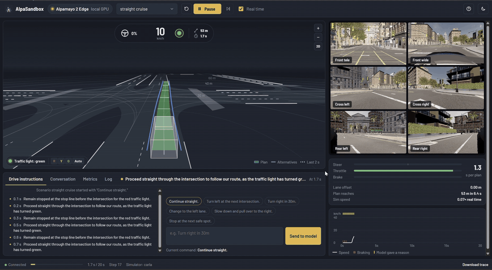

<sub>Alpamayo 2 Edge driving CARLA Town10 from its own six-camera input (24 seconds at 5× speed).</sub>

</div>

AlpaSandbox gives a driving vision-language-action (VLA) model a car. It renders the model's exact multi-camera input from a simulator (CARLA, or a built-in one that needs nothing installed), runs the model, drives with the trajectory it returns, and shows everything live: a 3D driving view, six cameras, the model's Chain-of-Causation reasoning, speed and braking, and closed-loop metrics.

You can steer the model while it drives. Send a **navigation command** ("Turn right in 30m") and it conditions the next plan. Or **ask it a question** about what it sees ("Is it safe to change lanes?"). The simulation waits while the model answers.

## A tour of the app

<p align="center">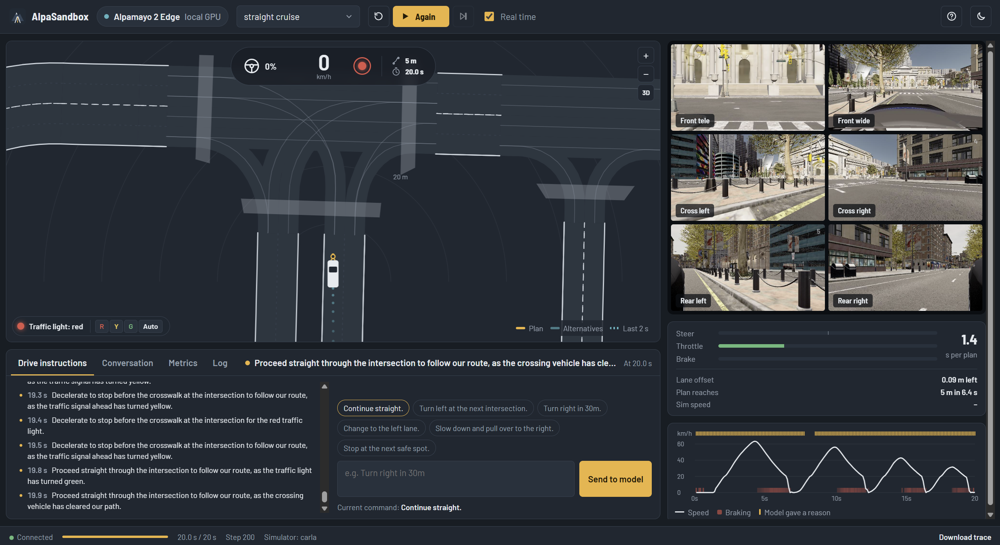</p>

The driving view takes the top left, the cameras and vehicle state sit on the right, and the tabs below hold drive instructions, the conversation, metrics and the log.

### Driving view

A tilted chase camera follows the car. The plan is drawn as a ribbon one car wide with one-second marks, the path driven so far as a cyan line, and other road users as 3D boxes. The HUD shows the steering command, speed, how far the plan reaches, and simulated time. Switch to a flat top-down view with **2D**, and zoom with **+** and **−**.

<p align="center">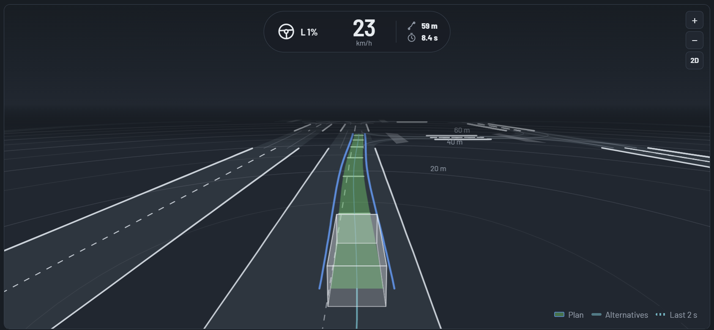</p>
<p align="center">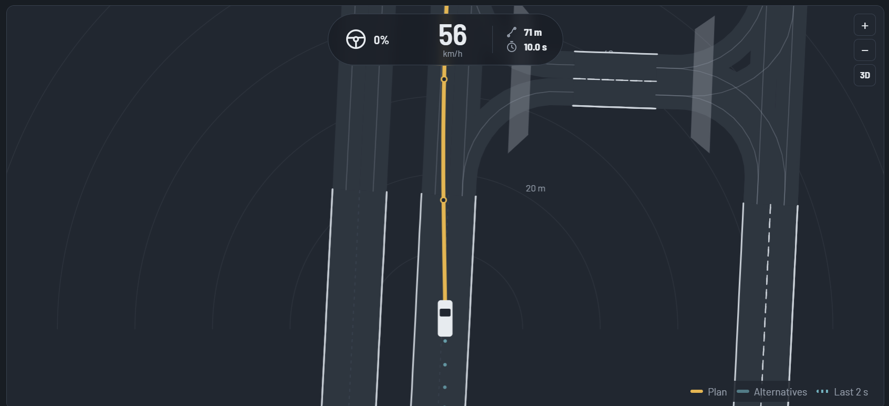</p>

### What the model sees

The six cameras Alpamayo 2 Edge uses, ordered front to back. They are mounted at the medians of NVIDIA's [PhysicalAI-AV](https://huggingface.co/datasets/nvidia/PhysicalAI-Autonomous-Vehicles) rig calibration (see [docs/calibration.md](docs/calibration.md)). Click a camera, or press 1–6, to enlarge it.

<p align="center">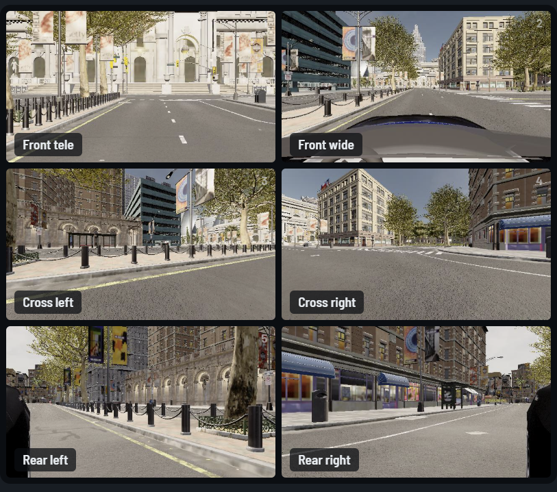</p>

### Drive instructions and reasoning

Send a navigation command, or pick a preset. Each change in the model's reasoning appears as a timed bullet under the command that prompted it, and the latest one is shown in the tab bar.

<p align="center">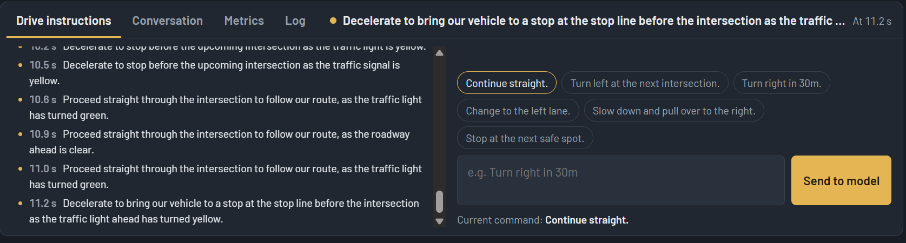</p>

### Ask the model

Free-form questions about the current scene, answered by the model's VQA head from the cameras alone. The simulation pauses while it answers.

<p align="center">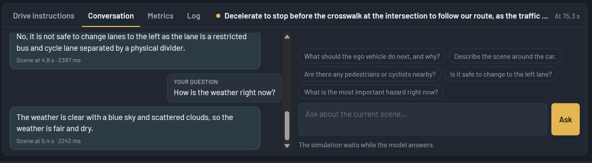</p>

### Vehicle state, metrics and traffic lights

Steering, throttle and brake, plan latency, lane offset, and speed over the episode, with braking shaded and a mark wherever the model gave a reason. In CARLA towns you can hold the ego's traffic light at red, yellow or green to test the model.

<p align="center">
  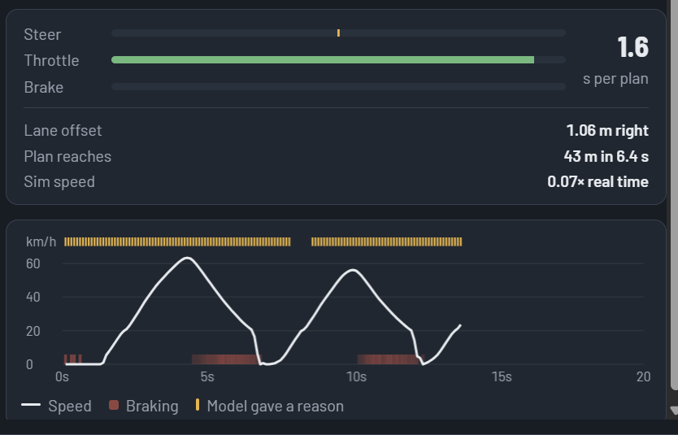
  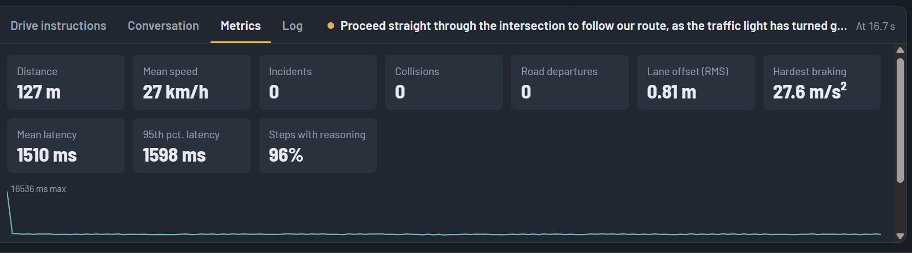
</p>
<p align="center">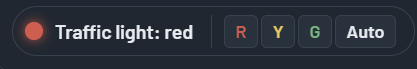</p>

The **Log** tab lists what the app is doing: backend start, model load time, scenario changes and traffic light overrides.

<p align="center">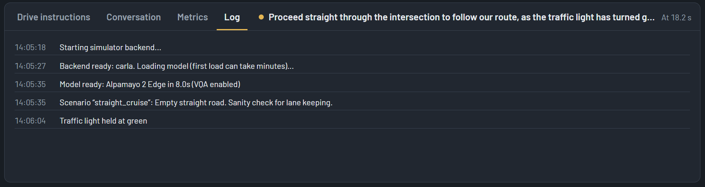</p>

## Highlights

- **Alpamayo 2 Edge and Super, out of the box.** Adapters follow NVIDIA's own inference code: the 22-image Edge driving profile, the 24-image Edge VQA profile, and the seven-camera Super ring with upstream task selection.
- **Runs where your GPU is.** Same process, a separate Python environment, inside **WSL2 from Windows** (CARLA on Windows, model in Linux), or on a remote GPU server over HTTP.
- **Closed loop, synchronous.** The simulator waits for the model, so a 1.5-second plan on a laptop GPU still drives correctly. The controller tracks the whole plan, not just its first second, and handles the throttle dead band of a car pulling away from rest.
- **Nine scenarios, YAML-defined**: pedestrian crossing, occluded pedestrian, cut-in, lead-vehicle braking, slow lead, oncoming traffic, cone obstruction, S-curves, straight cruise. In CARLA they are built as real roads with OpenDRIVE, or run in any town with optional traffic.
- **Bring your own model.** Implement `act()` (and optionally `query()`), then register it with an entry point or pass `--model my_pkg.mod:MyPolicy`. The app, metrics and HTTP API work unchanged.
- **Reproducible output.** Per-step JSONL traces (pose, controls, plan, reasoning, latency, controller and simulator internals), a headless `run --all` mini-benchmark, and `doctor` to check a setup.

## Quick start (no GPU, two minutes)

AlpaSandbox is a standalone package. It runs on its own with a built-in simulator and a rule-based driver. The model (Alpamayo 2 Edge) and the simulator (CARLA) are optional, installed separately when you want them.

```bash
pip install git+https://github.com/MrShahzebKhoso/alpasandbox
alpasandbox app --model oracle
```

Open <http://localhost:8000>. `oracle` is a rule-based test fixture that reads ground truth, so you can try the whole app before installing a model. From a clone, use `pip install -e .` instead of the first line.

## With Alpamayo 2 Edge

AlpaSandbox does not include NVIDIA's model code. Install NVIDIA's [alpamayo2-edge](https://github.com/NVlabs/alpamayo2-edge) package into the same environment (or point AlpaSandbox at its environment). You need an NVIDIA GPU with at least 16 GB, Python 3.12, and access to [nvidia/Alpamayo2-Edge](https://huggingface.co/nvidia/Alpamayo2-Edge) on Hugging Face (`hf auth login`).

| Your setup | Run |
|---|---|
| **Linux** (or inside WSL), one environment | `pip install "alpamayo2-edge @ git+https://github.com/NVlabs/alpamayo2-edge"`<br>`alpasandbox app --model edge` |
| **Windows + WSL2**: CARLA on Windows, model in WSL | `alpasandbox app --model edge --runtime wsl --wsl-distro Ubuntu-24.04 --wsl-workdir ~/alpamayo2-edge --wsl-venv .venv --backend carla` |
| **Model in its own venv** (keeps torch pins separate) | `alpasandbox app --model edge --runtime subprocess --worker-python ~/alpamayo2-edge/.venv/bin/python` |
| **Remote GPU** | GPU box: `alpasandbox serve-model --model edge`<br>Laptop: `alpasandbox app --model edge --runtime remote --remote-url http://gpu-box:8100` |

Run `alpasandbox doctor` with the same flags to check every piece before the first launch. Step-by-step guides for each setup are in [docs/installation.md](docs/installation.md).

### Driving in CARLA

Start CARLA 0.9.16 (`CarlaUE4 -RenderOffScreen -quality-level=Low -nosound` works well on a shared laptop GPU), then:

```bash
export HF_HUB_OFFLINE=1 PYTORCH_CUDA_ALLOC_CONF=expandable_segments:True
alpasandbox app --backend carla --carla-host <windows-host-ip> --carla-town Town10HD_Opt \
  --model edge --set accel=tuned --set attn_implementation=flash_attention_2
```

`accel=tuned` uses NVIDIA's acceleration in `alpamayo2_edge.accel` and needs flash-attn. The first plan compiles CUDA graphs and takes about 15 seconds; later plans take about 1.5 s on a 16 GB laptop GPU shared with CARLA. Other useful settings: `--set num_traj_sets=3` draws alternative plans, `--set diffusion_steps=5` trades accuracy for speed, and `--set model_id=/path/to/checkpoint` loads local weights. Put persistent settings in `alpasandbox.toml` (`alpasandbox init` writes a commented one).

## Models

| Model | `--model` | Drives | Answers questions | GPU | Status |
|---|---|---|---|---|---|
| NVIDIA Alpamayo 2 Edge (2B) | `edge` | yes | yes | ≥ 16 GB | tested locally with CARLA (see below) |
| NVIDIA Alpamayo 2 Super (34B) | `super` | yes | yes | ~80 GB | **experimental**, untested; use `--runtime remote` |
| Oracle (ground truth) | `oracle` | yes | templates | none | test fixture |
| Cruise | `cruise` | yes | no | none | blind baseline |
| Your model | `pkg.module:Class` | | | | see [docs/adding-a-model.md](docs/adding-a-model.md) |

## What has been tested

On one machine: Windows 11 with CARLA 0.9.16, the model in WSL2 Ubuntu with the `local` runtime, an RTX 4090 Laptop GPU (16 GB) shared by CARLA and Alpamayo 2 Edge, Town10HD_Opt.

| Check | Result |
|---|---|
| Edge loads, drives, reasons and answers questions | Yes, about 1.5 s per plan with `accel=tuned` and flash-attn |
| Pulls away from a stop line when the light turns green | Yes, within two plans |
| Light switched to red about 25 m out at 50 km/h | Stops before the line |
| Holds at a red light after stopping | **Not reliably.** Edge sometimes decides to go on red ("the light has turned green"). This is the model's decision, not the controller's |
| Lane keeping on Town10 straights | No collisions in 15-second runs, but Edge holds the car up to about 1 m off the lane centre |

Not tested on real hardware yet: the `subprocess`, `wsl` and `remote` runtimes, Alpamayo 2 Super, Linux-native CARLA, and the town placement of scenario actors (pedestrians and vehicles placed along the lane can land on kerbs and fail to spawn; the Log tab warns when they do). Reports from other setups are very welcome.

## How it works

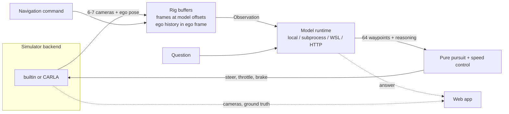

Each model publishes an `InputSpec` that lists which cameras it needs, at which time offsets, and how many ego poses. The rig builds exactly that from a rolling buffer, so Edge gets its 22 images and Super gets its 7 × 4 ring from the same simulator. More detail: [docs/architecture.md](docs/architecture.md).

## Command line

```text
alpasandbox app          web app (alias: demo)
alpasandbox run          headless closed loop; --all runs every scenario, --trace writes JSONL,
                         --signal / --signal-at hold or switch a CARLA traffic light, --steps limits length
alpasandbox serve-model  HTTP model server for a remote GPU
alpasandbox smoke        load the model, time a few plans and one question
alpasandbox doctor       check Python, GPU, model packages, CARLA, WSL and config
alpasandbox models       list models, and how to install the missing ones
alpasandbox scenarios    list scenarios
alpasandbox init         write a commented alpasandbox.toml
```

## What this is, and what it is not

The built-in renderer is schematic, and even CARLA imagery differs from the real-world video Alpamayo was trained on. The simulated cameras use the real rig's mounts but pinhole lenses, while the real wide cameras are f-theta. Treat results as qualitative and comparative. This is **not** safety validation. `Incidents` counts collisions and road departures without judging fault, so it is not comparable to NVIDIA's at-fault figures. Traffic-light states shown in the app come from the simulator; the model only sees the cameras.

## Contributing

Issues and pull requests are welcome, especially new scenarios, model adapters, and test reports from different GPUs and platforms. Please include your `alpasandbox doctor` output. See [CONTRIBUTING.md](CONTRIBUTING.md).

## Citation

If AlpaSandbox helps your research, please cite it (GitHub shows a "Cite this repository" button from [CITATION.cff](CITATION.cff)):

```bibtex
@software{khoso_alpasandbox_2026,
  author  = {Khoso, Shahzeb},
  title   = {AlpaSandbox: an interactive closed-loop sandbox for driving vision-language-action models},
  year    = {2026},
  version = {0.3.0},
  url     = {https://github.com/MrShahzebKhoso/alpasandbox}
}
```

## License

AlpaSandbox code is Apache-2.0. It does not include NVIDIA's code or weights: the Alpamayo model code is Apache-2.0 and the weights are released by NVIDIA under OpenMDW-1.1, both installed separately. CARLA keeps its own licenses. This project is not affiliated with or endorsed by NVIDIA.
